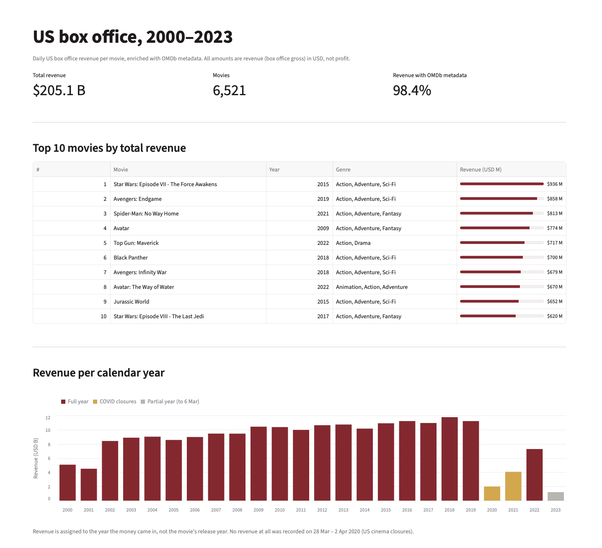
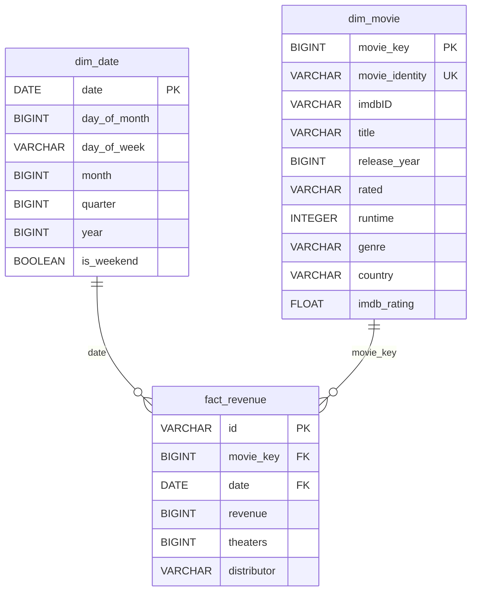

# US Box Office Data Pipeline

Daily US box office revenue per movie (2000-2023), enriched with OMDb metadata, modeled as a star schema in DuckDB, with a Streamlit dashboard on top.

Stack: Python, pandas, DuckDB, SQL, requests, Streamlit.

The main problem: a title is not a movie, because remakes and re-releases share titles. After splitting titles into screening runs, 93.2% of runs matched OMDb, which covers 98.4% of revenue.

It started as a take-home task in a data engineering recruitment process. I keep working on it, plans are in the Roadmap at the bottom.

## Data sources

- Revenue: Box Office Mojo, from [tjwaterman99/boxofficemojo-scraper](https://github.com/tjwaterman99/boxofficemojo-scraper) (revenues_per_day.csv), snapshot 2000-01-01 to 2023-03-06.
- Metadata: [OMDb API](https://www.omdbapi.com/), personal non-commercial use. data/omdb_raw.json keeps the API responses, so you don't need a key.

## How to run

Tested with Python 3.13.

1. `python3 -m venv .venv`, `source .venv/bin/activate`, `pip install -r requirements.txt`
2. Run `pipeline.ipynb` top to bottom (VS Code or Jupyter). It builds `data/movies.duckdb`.
3. In the terminal: `streamlit run app.py`

No API key is needed: if `data/omdb_raw.json` exists, the pipeline reads it and makes no API calls, and the cells that demo the API are skipped. To query the API again, delete the file and put your own key in `.env` as `API_KEY=...` (full run ~33 min).

The notebook closes the DuckDB connection at the end. DuckDB allows one writing process or several reading ones, so the dashboard can't open the database while the notebook holds it.

## Pipeline

csv → raw_revenues → stg_revenue → stg_series → OMDb API → omdb_raw.json → stg_omdb → dim_movie, dim_date, fact_revenue → dashboard

## Data exploration

- 337,818 rows, 6,545 unique titles, dates 2000-01-01 to 2023-03-06
- 0.05% nulls in theaters. Distributor: 225 nulls plus 7,419 rows with "-" as a placeholder, so 2.3% missing after labeling them correctly.
- Avengers: Endgame earned $157M on opening day, which is true, so revenue is in USD. There are 63 rows with 0 USD.
- id is unique for title and day, not for distinct movies.
- Some movies are remakes and some are re-releases, so a title is not a movie (The Kid 2000 and 2019, Hellboy 2004 and 2019).

## Staging

stg_revenue: one row per movie per day.
- series_number: if there is no previous date, or the gap is larger than a year (365 days), the screening ended and we treat it as another run. It's a hypothesis, checked later with OMDb.
- base_title: some titles are labeled with a year and "Re-release" or "Anniversary" (Maurice2017 Re-release, The Polar Express2005 IMAX Release). 341 titles have "release" or "anniversary" in the name. A regex removes the label only at the end of the title, so it can be used for the OMDb search.
- distributor "-" replaced with NULL.

stg_series: one row per screening run, 6,634 runs. Sum of revenue is the same in stg_revenue and stg_series (205,110,995,141).

## OMDb enrichment

- One query per run, using type "movie" to avoid other types (series, episodes).
- If it's a re-release: title without year (OMDb knows the original year).
- Otherwise: title and year, and if the year doesn't work, year - 1 (premiere dates, festivals).
- Normal movies are never searched without a year: The Kid without a year returns Chaplin's 1921 film.
- stg_omdb: 'N/A' replaced with nulls, numbers cast from strings.
- 6,185 of 6,634 runs matched (93.2%), and 98.4% of revenue is from movies matched with an IMDb ID. The 449 unmatched runs are 6.8% of runs but only 1.6% of revenue, so they are mostly small titles.

## Data model

Star schema. Grain of the fact: one row per movie per day.

dim_date is generated, not taken from the csv.

Decisions:
- Movie identity: imdbID if possible, else title + release_year. Runs with the same imdbID (re-releases) become one movie. 6,634 runs → 6,521 movies, 6,072 with imdbID.
- movie_key is a surrogate key (ROW_NUMBER). Identity has two formats and can change after better matching, so the fact points to a number. It's consistent because everything is rebuilt on each run.
- distributor stays in the fact (degenerate dimension): no other attributes, and it can change between runs of the same movie.
- theaters is semi-additive: sum across movies on one day, not across days.
- genre and country stay as strings (lists like "Action, Drama").

Checks:
- stg_revenue has the same number of rows as the source (337,818), no "-" left in distributor
- The Kid splits into 2 runs (2000 and 2019)
- same revenue sum in stg_revenue, stg_series and fact_revenue (205,110,995,141)
- same number of records in fact_revenue and stg_revenue (337,818)
- movie_identity and imdbID are unique in dim_movie
- dim_date has 8,466 days, the data has 8,455. 11 dates have no revenue at all, 6 of them are 28 Mar - 2 Apr 2020 (US cinema closures)

## Dashboard

- Top 10 movies by total revenue
- Revenue per calendar year (2020-2021 COVID, 2023 only until 6 March)
- Average revenue per movie by release year. 2000-2001 look highest, but the source has only 85 and 110 movies from those years, compared with 200+ later (mostly big releases early on), so it's a data coverage effect, not a trend.
- Top 100: not even one movie without United States in countries. If we only count the first listed country, 18 movies are not US.
- Average revenue per day of the week: Saturday ~$47.5M, Friday and Sunday $33-39M, Monday-Thursday $12-14M.

## Limitations

- genre and country as strings, no bridge table
- 1.6% of revenue without OMDb metadata
- the regex covers the main label patterns, a few unusual labels may remain
- the 365-day gap for splitting runs is an assumption

## Roadmap

- [x] v1.0: notebook pipeline, star schema in DuckDB, dashboard
- [ ] v2.0: move the pipeline to dbt (dbt-duckdb), checks as dbt tests
- [ ] v2.0: download the source file instead of keeping a copy in the repo
- [ ] v2.1: bridge tables for genre and country
- [ ] v2.1: dashboard online

## Use of AI

I used Claude (Anthropic) as a mentor during this project: to explain concepts (gaps and islands, surrogate keys, semi-additive measures), to help with syntax (the regex for release labels, DuckDB functions) and to review my notebook. The Streamlit dashboard code was written with Claude, based on my SQL queries. The data exploration, the data model and the decisions described above are mine, and I can explain every step of the pipeline.

## License

Code: MIT (see [LICENSE](LICENSE)). Data belongs to its sources listed above.
